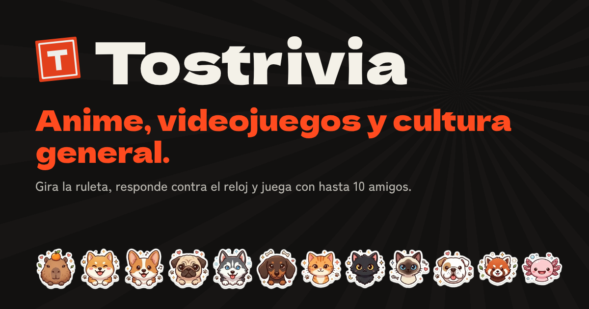
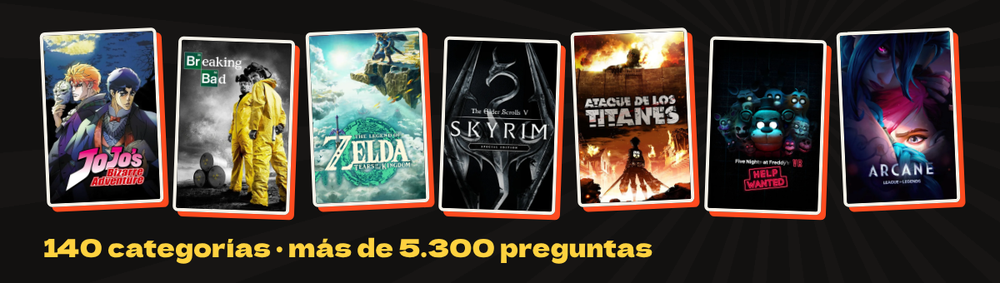

<div align="center">



[English](README.md) · **Español**


</div>

## ¿Qué es Tostrivia?

Tostrivia es una trivia para fans. Giras una ruleta, te salen 10 preguntas y respondes antes de que se acabe el tiempo. Mientras más rápido contestes y más larga sea tu racha, más puntos sumas.

Funciona en el navegador, así que no hay nada que descargar ni cuenta que crear. Abres la página, eliges un nombre y juegas.



## Qué puedes hacer

- Dejar que la ruleta elija tu próxima ronda. La puedes filtrar por Anime, Juegos, Series y pelis o Cultura, elegir tú la categoría, o mezclar varias en una misma ronda.
- Jugar más de 5.300 preguntas en 140 categorías, de JoJo y Breaking Bad a Zelda, Skyrim y FNAF. Todas están en español y en inglés.
- Adivinar un anime por su opening o un juego por su banda sonora. La imagen queda tapada hasta que respondes.
- Adivinar una serie, película o juego por su póster. Empieza borroso, pixelado o con zoom a una esquina diminuta, y se va aclarando mientras corre el reloj.
- Abrir una sala de hasta 10 jugadores. Todos entran con un código desde su celular, y la sala tiene marcador en vivo, chat, emotes y un podio al final.
- Jugar con uno de 12 animales chibi, como capibara, shiba, corgi, pug, husky o ajolote.
- Armar tus propias reglas: cantidad de preguntas, tiempo por pregunta, dificultad, multiplicador de puntos y si cuenta la racha.

## Modo Locura

El modo Estándar es la trivia de siempre. Locura se parece más a Mario Party y Mario Kart: tu racha te da poderes y los usas antes de responder.

| | |
|---|---|
| ✂️ 50/50 | 🎰 Doble o nada |
| ⭐ Estrella | 🛡️ Escudo |
| 🔵 Caparazón azul | ⚡ Rayo |
| 👻 Boo | 🍌 Plátano |
| 🔁 Cambiazo | 🎲 Dado |

En una sala, otros poderes caen sobre las pantallas de tus amigos: pueden voltearse, temblar, llenarse de niebla, quedar en negro con solo una linterna, revolver las opciones o recibir un susto. Ultra Locura da más poderes y deja usar dos por pregunta.

## Correrlo en local

```bash
npm install
npm run dev      # http://localhost:5173
```

Es una web estática. Se despliega en Vercel sin configuración ni API keys.

## Stack

React 18, TypeScript y Vite, con Framer Motion para las animaciones y [PeerJS](https://peerjs.com/) (WebRTC) para las salas. Sin backend: el anfitrión de cada sala corre la partida en su navegador.

## Scripts

| Comando | Qué hace |
|---|---|
| `npm run dev` | Servidor de desarrollo en `localhost:5173` |
| `npm run build` | Revisa tipos y genera el build de producción en `dist/` |
| `npm run typecheck` | Solo revisión de tipos |
| `npm run content` | Convierte `content/*.mjs` en el banco de preguntas y sus traducciones |
| `npm run check:bank` | Cuenta preguntas por categoría y avisa de problemas |
| `npm run check:i18n` | Revisa que las traducciones estén completas |
| `npm run videos` | Resuelve y verifica los videos de YouTube (necesita `YOUTUBE_API_KEY`) |
| `npm run videos:sin-key` | Lo mismo sin API key, buscando en YouTube directamente |
| `npm run peer:local` | Servidor PeerJS local para probar salas |

## Estructura

```
content/            preguntas fuente, en español e inglés
public/             favicon e imagen para compartir
scripts/            herramientas de contenido y videos
src/
├── assets/         portadas y animales
├── components/     piezas de interfaz
├── data/           categorías, banco de preguntas y videos
├── game/           motor de partida, ruleta, poderes y reglas
├── i18n/           traducciones al inglés
├── lib/            utilidades (azar, historial, YouTube…)
├── net/            conexión de salas con PeerJS
└── pages/          inicio, categorías, sala y grupo
```

## Variables de entorno

Ninguna es obligatoria. Estas son opcionales (ver `.env.example`):

- `YOUTUBE_API_KEY`: solo para `npm run videos`, nunca se incluye en el build.
- `VITE_PEER_HOST`, `VITE_PEER_PORT`, `VITE_PEER_PATH`, `VITE_PEER_SECURE`: para usar tu propio servidor PeerJS en vez del público. Si lo haces, añade ese host a `connect-src` en la CSP de `vercel.json`.

## Despliegue

El repo trae `vercel.json` (framework Vite, salida `dist`, reescritura SPA y cabeceras de seguridad). Importa el repo en Vercel y despliega.

Las salas usan solo servidores STUN, sin TURN, así que en redes muy cerradas dos dispositivos pueden no conectarse.

## Colaborar

- Las preguntas están en `content/*.mjs`, escritas una sola vez en español e inglés. `npm run content` las convierte en datos del juego.
- `npm run check:bank` cuenta las preguntas por categoría y avisa de problemas.
- `npm run videos` busca y verifica los videos de YouTube. Necesita tu propia `YOUTUBE_API_KEY` en `.env`.
- Las salas usan WebRTC con [PeerJS](https://peerjs.com/), así que no hay base de datos ni servidor propio.

<sub>Juego de fans sin afiliación con ninguna de las obras que menciona. Los nombres de series, juegos, canciones y personajes son de sus dueños. Los videos se reproducen con el reproductor oficial de YouTube.</sub>
