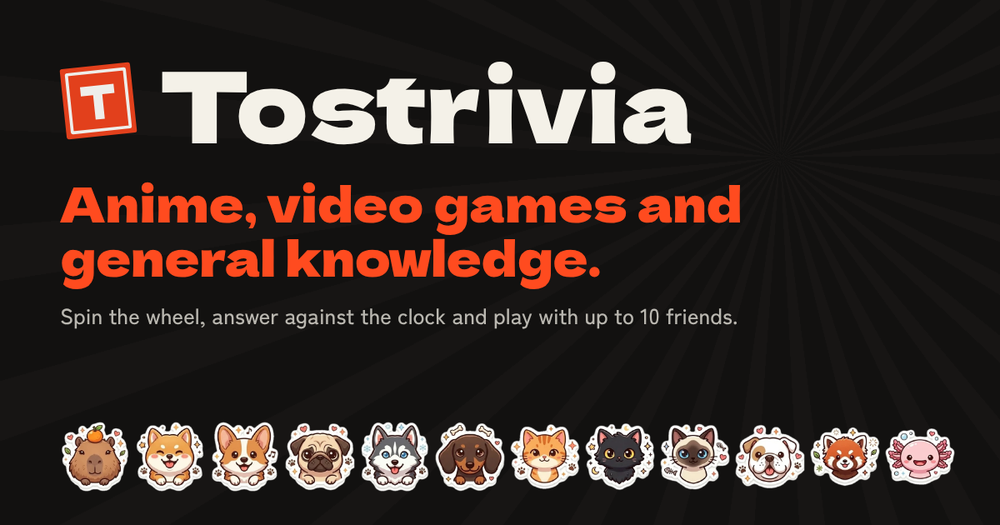
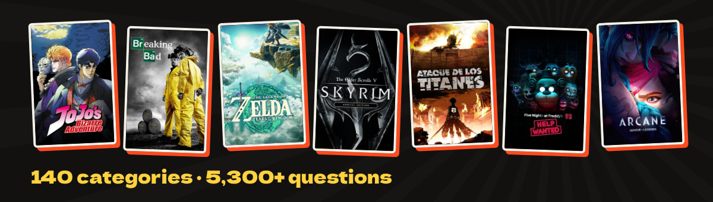

<div align="center">



**English** · [Español](README.es.md)


</div>

## What is Tostrivia?

Tostrivia is a trivia game for fans. You spin a wheel, get 10 questions and answer before time runs out. Faster answers and longer streaks earn more points.

It runs in the browser, so there is nothing to download and no account to make. Open it, pick a name and play.



## What you can do

- Let the wheel pick your next round. You can filter it by Anime, Games, Series & Movies or Culture, choose a category yourself, or mix several categories in one round.
- Play over 5,300 questions across 140 categories, from JoJo and Breaking Bad to Zelda, Skyrim and FNAF. Every question is in English and Spanish.
- Guess an anime from its opening or a game from its soundtrack. The picture stays hidden until you answer.
- Guess a series, movie or game from its poster. It starts blurred, pixelated or zoomed in on a tiny corner, and clears up while the clock runs.
- Open a room for up to 10 players. Everyone joins from their own phone with a code, and the room has a live scoreboard, chat, emotes and a podium at the end.
- Play as one of 12 chibi animals, such as a capybara, shiba, corgi, pug, husky or axolotl.
- Set your own rules: number of questions, time per question, difficulty, point multiplier, and whether streaks count.

## Mayhem mode

Standard mode is classic trivia. Mayhem is closer to Mario Party and Mario Kart: your streak earns power-ups, and you use them before answering.

| | |
|---|---|
| ✂️ 50/50 | 🎰 Double or nothing |
| ⭐ Star | 🛡️ Shield |
| 🔵 Blue shell | ⚡ Lightning |
| 👻 Boo | 🍌 Banana |
| 🔁 Switcheroo | 🎲 Dice |

In a room, other power-ups hit your friends' screens: they can flip upside down, shake, fill with fog, go black except for a flashlight, scramble the answer options, or get a jump scare. Ultra Mayhem gives you more power-ups and lets you use two per question.

## Run it locally

```bash
npm install
npm run dev      # http://localhost:5173
```

It is a static web app. It deploys to Vercel without configuration or API keys.

## Contributing

- Questions live in `content/*.mjs`, written once in Spanish and English. `npm run content` turns them into game data.
- `npm run check:bank` counts questions per category and reports problems.
- `npm run videos` finds and verifies the YouTube clips. It needs your own `YOUTUBE_API_KEY` in `.env`.
- Rooms use WebRTC through [PeerJS](https://peerjs.com/), so there is no database or server of our own.

<sub>Fan-made game, not affiliated with any of the works it mentions. Names of series, games, songs and characters belong to their owners. Videos play through YouTube's official player.</sub>
